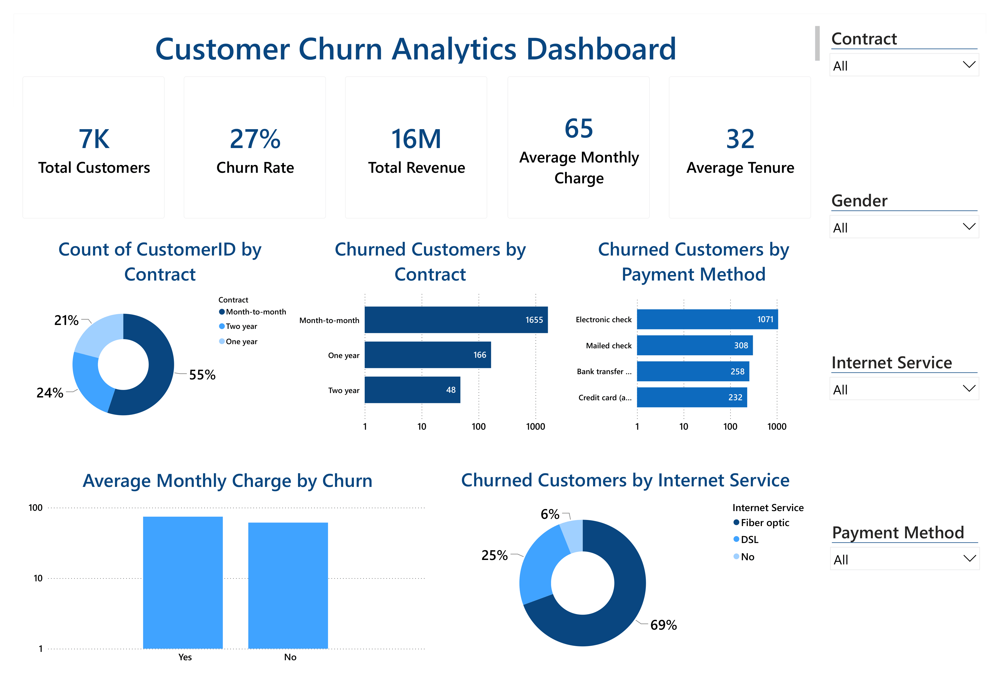

# 📊 Customer Churn Analysis

An end-to-end Data Analytics project that analyzes customer churn behavior using Python, SQL Server, and Power BI. The project covers the complete analytics workflow from data cleaning to business insights and interactive dashboard development.

 

## 🚀 Project Overview

Customer churn is one of the most important business challenges for subscription-based companies. This project analyzes customer behavior to identify the main factors affecting customer churn and provides business insights through SQL analysis and Power BI visualizations.

## 🛠️ Technologies Used

- Python
- Pandas
- NumPy
- Matplotlib
- SQL Server
- SQL
- Power BI
- VS Code

## 📁 Project Structure

```
Customer-Churn-Analysis/
│
├── Dataset/
│   ├── raw/
│   └── cleaned/
│
├── Images/
│   └── dashboard.png
│
├── PowerBI/
│   └── Customer_Churn_Dashboard.pbix
│
├── Python/
│   ├── 01_data_cleaning.py
│   ├── 02_exploratory_data_analysis.py
│   ├── 03_business_analysis.py
│   ├── 04_database_connection.py
│   └── 05_load_to_sql.py
│
├── SQL/
│   ├── 01_create_database.sql
│   ├── 02_create_table.sql
│   └── 03_business_queries.sql
│
├── requirements.txt
└── README.md
```

## 🔄 Project Workflow

```
Raw Dataset
      │
      ▼
Data Cleaning (Python)
      │
      ▼
Exploratory Data Analysis
      │
      ▼
Business Analysis
      │
      ▼
SQL Server (ETL)
      │
      ▼
Business SQL Queries
      │
      ▼
Power BI Dashboard
```

## 📈 Key Business Insights

- Overall customer churn rate is approximately **26.6%**.
- Customers with **Month-to-Month contracts** have the highest churn rate.
- **Electronic Check** users are the most likely to churn.
- Customers using **Fiber Optic** internet service show significantly higher churn.
- Customers who churn have higher monthly charges but lower lifetime value.
- Longer customer tenure is strongly associated with customer retention.

## 📌 Features

- Data Cleaning using Pandas
- Exploratory Data Analysis (EDA)
- Business KPI Analysis
- SQL Server ETL Pipeline
- Business SQL Queries
- Interactive Power BI Dashboard
- Customer Segmentation
- Revenue Analysis
- Churn Analysis

## 📂 Dataset

**IBM Telco Customer Churn Dataset**

The dataset contains customer demographic information, subscription details, billing information, and churn status.

Main features include:

- CustomerID
- Gender
- SeniorCitizen
- Contract
- Internet Service
- Payment Method
- Monthly Charges
- Total Charges
- Tenure
- Churn


## ⚡ SQL Analysis

The SQL section includes business-oriented queries such as:

- Overall Churn Rate
- Revenue Analysis
- Customer Segmentation
- Contract Analysis
- Payment Method Analysis
- Internet Service Analysis
- Executive KPI Summary
- Customer Lifetime Groups


## 📊 Power BI Dashboard

The interactive dashboard includes:

- Total Customers
- Churn Rate
- Total Revenue
- Average Monthly Charge
- Average Customer Tenure
- Churn by Contract
- Churn by Payment Method
- Churn by Internet Service
- Interactive Filters

## Dataset

This project uses the **IBM Telco Customer Churn Dataset**, which is publicly available on Kaggle for learning and data analysis purposes.

Source:
https://www.kaggle.com/datasets/blastchar/telco-customer-churn

## 👤 Author

**Mete Arabacı**
